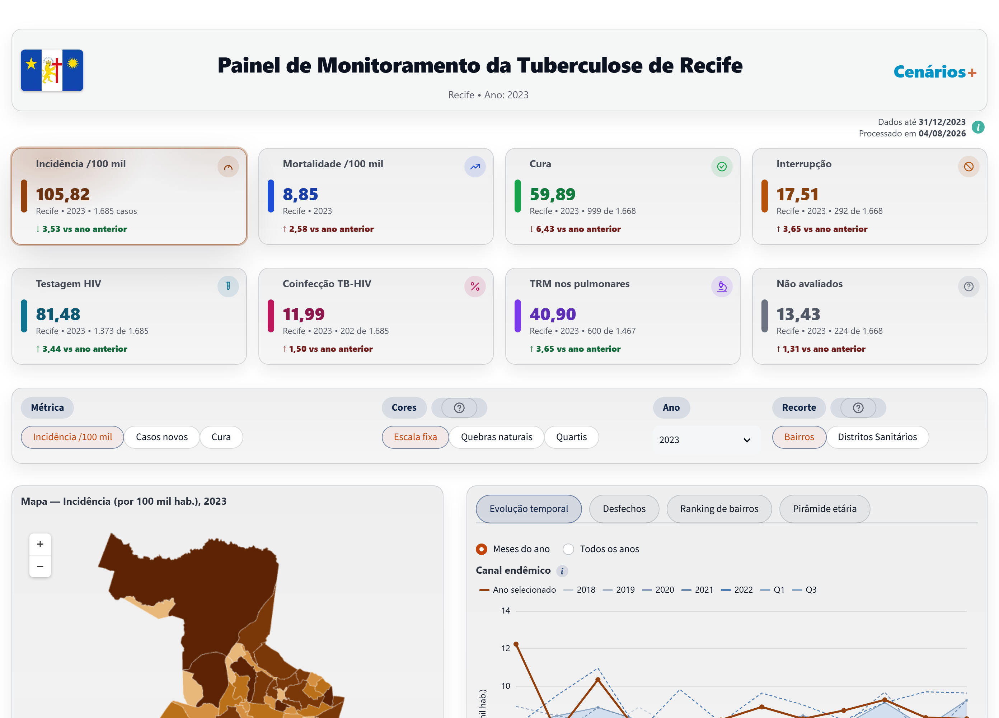

# Painel de Monitoramento da Tuberculose — Recife

[](https://github.com/Dev-Cenarios/painel-tuberculose-recife/actions/workflows/ci.yml)


Painel de vigilância da tuberculose no Recife, por **bairro** e **Distrito
Sanitário**, com os oito indicadores do Boletim Epidemiológico de
Tuberculose do Ministério da Saúde: incidência, mortalidade, cura,
interrupção, testagem HIV, coinfecção TB-HIV, teste rápido nos pulmonares e
não avaliados.

**No ar:** <https://painel.cenarios.unb.br/cenarios/tbrecife/>



Cada número, a conta e a distância até o Boletim estão em
[`docs/metodologia.md`](docs/metodologia.md).

Painel feito em Python (Streamlit) e entregue como uma **imagem Docker pronta**.

**Os dados já vêm dentro da imagem.** Não precisa configurar banco de dados nem apontar pasta de dados: carregou a imagem, subiu o container, o painel está no ar.

## Para quem vai hospedar

**Só precisa ter Docker** (Docker Engine 24 ou mais novo, ou o Docker Desktop).

### 1. Carregar a imagem

A gente entrega um arquivo chamado `recifetb.tar.gz`. Para carregar:

```bash
docker load -i recifetb.tar.gz
```

Para conferir se carregou:

```bash
docker image ls recifetb
```

### 2. Subir o painel

**Jeito mais simples**, direto na porta 8501:

```bash
docker run -d --name recifetb --restart unless-stopped -p 8501:8501 recifetb:latest
```

Depois é só abrir `http://<endereço-do-servidor>:8501/`.

**Em outra porta e num caminho próprio**, por exemplo atrás de um nginx que encaminha `/cenarios/tbrecife/`:

```bash
docker run -d --name recifetb --restart unless-stopped \
  -p 8080:8501 \
  -e BASE_URL_PATH=cenarios/tbrecife \
  recifetb:latest
```

Depois é só abrir `http://<endereço-do-servidor>:8080/cenarios/tbrecife/`.

**Ou com o `docker-compose.yml` que vem junto:**

```bash
PORTA=8080 BASE_URL_PATH=cenarios/tbrecife docker compose up -d
```

> ⚠️ **Atenção: com o `docker-compose.yml`, a porta só abre para a própria máquina** (`127.0.0.1`), por segurança. Ou seja, o painel **não** abre direto de outro computador em `http://<servidor>:8080`. Ele é feito para ficar **atrás de um nginx** na mesma máquina (veja "Proxy reverso" abaixo). Se você quer acessar direto, sem nginx, use o `docker run -p ...` acima.

### Configuração

| Variável | Padrão | Para que serve |
|---|---|---|
| `BASE_URL_PATH` | vazio | O "caminho" do painel no endereço. Escreva **sem** barra no começo e no fim (`cenarios/tbrecife`). Vazio = o painel fica na raiz. |

**Só essa.** Dentro do container a porta é sempre 8501. Para mudar a porta de fora, troque o primeiro número do `-p` (ou a variável `PORTA`, no compose).

### Proxy reverso (nginx)

O Streamlit mantém uma conexão aberta com o navegador (WebSocket). Por isso, o bloco do nginx precisa destas linhas:

```nginx
location /cenarios/tbrecife/ {
    proxy_pass http://127.0.0.1:8080/cenarios/tbrecife/;
    proxy_http_version 1.1;
    proxy_set_header Upgrade $http_upgrade;
    proxy_set_header Connection "upgrade";
    proxy_set_header Host $host;
    proxy_read_timeout 86400;
}
```

**O `BASE_URL_PATH` do container tem que ser igual ao caminho do `location`.** Senão a página abre em branco.

### Como saber se está funcionando

A imagem se testa sozinha (`HEALTHCHECK`). Uns 40 segundos depois de subir, o `docker ps` mostra o container como `healthy`.

Para testar na mão, abra `http://<servidor>:<porta>/<BASE_URL_PATH>/_stcore/health`. A resposta deve ser `ok`.

### Quanto de máquina precisa

Medimos uns **300 MB de memória** em uso normal. Esse número sobe quando várias pessoas usam ao mesmo tempo.

O `docker-compose.yml` limita o container a **1,5 GB de memória e 2 CPUs**, o que é bem mais do que o painel usa. O limite existe para que, se algo der errado, o painel não derrube a máquina inteira.

### Atualizar os dados

Como os dados ficam dentro da imagem, **dado novo = imagem nova**. A gente entrega outro `recifetb.tar.gz`, e aí é só carregar e recriar o container:

```bash
docker load -i recifetb.tar.gz
docker rm -f recifetb
docker run -d --name recifetb --restart unless-stopped -p 8501:8501 recifetb:latest
```

## Privacidade

**A imagem não tem nenhum dado que identifique paciente.**

- O dado que vai dentro da imagem é um arquivo Parquet do qual já foram tirados **27 campos de identificação**: nome, nome da mãe, data de nascimento, cartão do SUS, CEP, telefone, endereço, coordenadas, número da notificação, entre outros.
- O arquivo original (CSV), que tem esses campos, **nunca entra na imagem**. O `.dockerignore` barra.
- O teste `tests/test_imagem.py` **abre a imagem pronta e confere** que não tem CSV, nem a pasta de origem, nem coluna de identificação lá dentro.

## Para quem desenvolve

Para rodar no seu computador:

```bash
python -m venv .venv && .venv/Scripts/activate      # no Linux/Mac: source .venv/bin/activate
pip install -r requirements.lock.txt
streamlit run app.py
```

**Os dados que o painel usa** são gerados a partir da pasta `data/origem/`, que **não vai para o git**, por dois scripts:

- `scripts/preparar_microdado.py`: lê o CSV original, tira os identificadores e grava o Parquet;
- `scripts/preparar_geometria.py`: prepara o contorno dos bairros e distritos para o mapa.

**Testes:** rode `pytest`. Sem a pasta `data/`, os testes que precisam de dado são pulados. Sem a imagem `recifetb:latest` construída, os testes da imagem também são pulados.

**Para montar a imagem e gerar o arquivo de entrega:**

```bash
docker build -t recifetb:latest .
pytest tests/test_imagem.py
docker save recifetb:latest | gzip > entrega/recifetb.tar.gz
```

O `pytest tests/test_imagem.py` fica **antes** do `docker save` de propósito: se ele falhar, a imagem não vai para ninguém.

## Onde ler mais

| Arquivo | Para quem | O que explica |
|---|---|---|
| [`docs/metodologia.md`](docs/metodologia.md) | Quem usa o painel | Cada indicador, o mapa e o canal endêmico: a conta e o motivo de cada um. |
| [`docs/dados.md`](docs/dados.md) | Quem prepara os dados | De onde vêm os dados, quais arquivos o painel lê, como são preparados, privacidade e armadilhas. |
| [`docs/paridade-com-o-painel-r.md`](docs/paridade-com-o-painel-r.md) | A equipe parceira (do painel em R) | Cada diferença entre este painel e o painel em R, medida e explicada, e o que ainda está em aberto. |
| [`docs/publicacao.md`](docs/publicacao.md) | Quem cuida do painel | O painel no ar no nosso servidor: endereço, container e como atualizar. |
| [`docs/performance.md`](docs/performance.md) | Quem cuida do painel | Quanto tempo cada leitura de dados leva hoje, para comparar no futuro. |
| [`desenvolvimento.md`](docs/desenvolvimento.md) | Quem cuida do código | Arquitetura, comandos e armadilhas do código. |

## Família Cenários+

| Painel | Repositório |
|---|---|
| Tuberculose — Brasil | [painel-tuberculose-brasil](https://github.com/Dev-Cenarios/painel-tuberculose-brasil) |
| Tuberculose — Pernambuco | [painel-tuberculose-pernambuco](https://github.com/Dev-Cenarios/painel-tuberculose-pernambuco) |
| Tuberculose — Recife | [painel-tuberculose-recife](https://github.com/Dev-Cenarios/painel-tuberculose-recife) |
| Tuberculose — Distrito Federal | [painel-tuberculose-df](https://github.com/Dev-Cenarios/painel-tuberculose-df) |
| Hanseníase — Brasil | [painel-hanseniase-brasil](https://github.com/Dev-Cenarios/painel-hanseniase-brasil) |
| Hanseníase — Pernambuco | [painel-hanseniase-pernambuco](https://github.com/Dev-Cenarios/painel-hanseniase-pernambuco) |
| Hanseníase — Distrito Federal | [painel-hanseniase-df](https://github.com/Dev-Cenarios/painel-hanseniase-df) |

## Como citar e licença

Se usar o painel ou o código num trabalho, use o botão **"Cite this
repository"** aqui no GitHub, que lê o [`CITATION.cff`](CITATION.cff).

O código é aberto, sob a licença [MIT](LICENSE): pode ser usado, copiado e
adaptado, desde que o aviso de copyright do Projeto Cenários vá junto. A
licença vale para o código. Os dados são do Ministério da Saúde e da Prefeitura do Recife, e seguem as regras de cada fonte.
